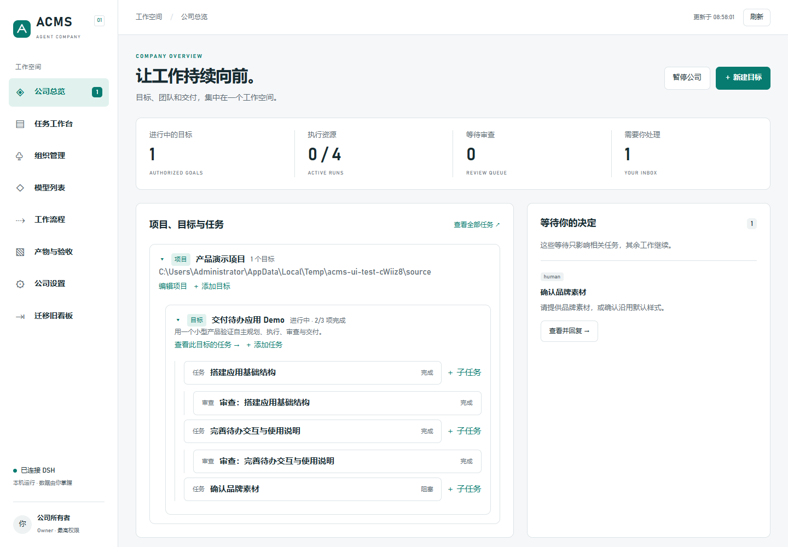

# ACMS

**Agent Company Management System** — 在 DeepSeek Harness 内运行的 AI 公司任务系统。

所有者提出目标并选择目标模板；负责人按模板自动拆分；执行员交付文件并通过检查。审查是**用户按需添加的独立子任务**，只核对交付成果；基础模板在目标交付时做一次总体审查。返工由项目负责人调度，依赖解锁和局部阻塞由持久调度器衔接。日常操作在 DSH 的 ACMS 面板中完成。

这是可运行的 **0.1.0 Demo**，已经验证真实 DSH 插件加载。公司数据保存在独立目录，任务由 DSH 宿主调度。



## 已实现

- 公司总览、任务看板、可点击依赖图、任务详情、实时进度、角色编辑、目标模板编辑、产物与验收记录、阻塞回复。
- 长文本与长列表默认折叠；项目、目标、子任务按对象记忆展开状态。已完成目标与任务进入独立列表，主视图保留进行中任务和仍含未完成后代的父级；列表按最近有效业务活动排序，进度/心跳不会置顶。
- 授权目标内自动拆解任务、按需创建临时执行员。常驻负责人和审查员；每轮结束释放进程；上下文是否续接取决于所选模型运行环境，和角色是否常驻分开。
- 默认最多 4 个 AI 执行，并为协调/审查预留资源。执行、重试、清理和恢复均留有记录。
- 文件产物与 SHA-256 标识、所有者配置的检查、可选的独立审查子任务、返工与重新审查。任务是最小执行粒度，不设阶段；执行员不能自行将任务标为完成。审查取消后可在面板基于当前交付重新发起，不重跑实现，也不会复用旧批准。
- 效率时间盒到点会保存检查点并交给负责人收尾，不等同于成本硬上限追加交互。
- Git worktree 或独立目录副本。可选自动合并：先在隔离候选工作区验证，再更新干净的源项目。
- 可恢复阻塞（审查环境、服务失败/重试耗尽、选模无候选、集成冲突）自动交给目标负责人协调解阻；重复上报幂等复用，负责人处理结束后同类阻塞回到所有者，避免自动循环。仅新增权限、必须由所有者提供的材料、跨范围重大变化、真实预算不足等阻塞给所有者。技术修复自动重试并按上限收敛。新的业务目标与公司硬边界由所有者控制。
- SQLite WAL、幂等命令、版本冲突检查、单调度器租约、持久事件游标、重启恢复。执行状态不明时先核对，不盲目重复运行。

## 快速开始

已验证环境：Windows、Node.js 24、Git、DSH `0.2.1-rc.5`。其他 DSH 版本应先在独立 profile 验证 ABI。

```powershell
cd D:\ACMS
npm ci
npm run build
npm test
```

安装到已有 DSH profile：

```powershell
pwsh -File .\scripts\install.ps1 -TargetProfile desktop
```

安装脚本通过 DSH 官方 `plugin add` 命令注册包，并仅维护 profile patch 中带标记的 ACMS 配置块。脚本不重启 DSH。待现有工作可安全停止时重启宿主，点击侧边栏 **ACMS**。

默认只使用 DSH 内部模型。外部模型在面板中生成配对 prompt，交给目标 agent 准备本机运行入口，经核对后加入列表；详见 [外部模型配对](docs/external-models.md)；偏好与选择依据见 [模型偏好](docs/model-preferences.md)。外部智能体接入 v1：owner 在面板“外部接入”签发有范围凭据，关闭工作台后按 [首次接入指南](docs/external-agent-onboarding.md) 连接；协议见 [外部智能体接口](docs/agent-api.md)。

外部执行目前只在 Windows 上提供进程容器，依赖系统 .NET Framework64 的 `csc.exe`、命名管道与 Job Object；它不是安装其他 DSH 插件，也不放宽模型的 sandbox 或审批。

项目交付检查与自动合入候选检查使用同一 Windows 进程容器。任务停止或检查超时后，宿主核对进程树清理回执。缺少可信回执时，任务保留执行占位并等待核对。模型执行回执和宿主检查回执分别核对。

### 离线依赖准备与宿主检查

所有者可在「编辑项目 → 依赖准备」粘贴 JSON，或通过 `project.save` 提交相同的 `preparation` 对象。以下路径应替换为本机绝对路径。

```json
{
  "command": "C:/Program Files/nodejs/node.exe",
  "args": ["C:/Program Files/nodejs/node_modules/npm/bin/npm-cli.js"],
  "network": "offline-npm",
  "inputs": ["package-lock.json", "package.json"],
  "cacheSeed": "D:/npm-package-cache",
  "timeoutMs": 120000
}
```

- `offline-npm` 固定执行 `npm ci --offline --ignore-scripts --no-audit --no-fund`。它使用 v2 或 v3 npm 锁文件，只接受带完整性校验的 HTTPS 包及副本内部的 workspace 链接。项目目录中的 `.npmrc` 不用于离线准备。
- `cacheSeed` 可指向所有者已填充的 npm 缓存根目录。准备步骤只复制锁文件引用的内容缓存到当前副本的私有缓存。缺失缓存、锁文件不匹配或退出失败会记录为环境阻塞，模型启动次数为零。修正缓存或配置后可重试原任务。
- 其他工具使用 `network: "allow"` 明确授权联网，并提供绝对可执行文件、字面参数和相对输入文件列表。准备与宿主检查使用副本根目录和隔离的用户配置目录。命令由可信宿主按所有者配置执行，参数和项目文件中应避免存放凭据。
- 自定义准备命令会把路径参数中的脚本和文件按内容计入准备指纹。要复用准备结果，请用 `externalInputs` 列出命令间接读取的外部文件的绝对路径。只有副本内声明的输入和已识别的参数文件时，填写 `"externalInputs": []`。声明缺失或文件无法核实时，每次准备都会重新执行命令。
- 开发工作副本和单任务审查副本分别安装依赖。目标级审查目录只包含不可变交付物，读取各交付的版本化宿主证据。锁文件、声明的配置、运行时或平台变化会使准备标记失效。
- 每项验收检查从相同输入制作独立副本。验收记录包含输入指纹、检查版本、宿主环境、执行目录、退出码和日志摘要。检查可以生成新文件，改写现有输入时该次结果不能证明原交付通过。有效的同版证据可供独立审查使用，审查员仍需自行判断交付是否符合合同。
- 要复用检查或把通过结果作为当前审查证据，请在检查配置中用 `inputs` 列出检查依赖的文件，包括脚本间接读取的外部脚本和配置。参数里的绝对文件路径也会自动纳入指纹。检查只依赖验证副本和已绑定的参数文件时，填写 `"inputs": []`。缺少声明、文件无法核实或准备步骤允许联网时，宿主仍可执行检查并保留本次记录。

复现时使用无依赖工作副本和已填充的离线缓存，启动任务后在「产物与验收」展开「宿主检查证据」。修改锁文件后重新交付可验证证据更新。修改项目检查命令会使旧证据失去当前适用性，新任务读取更新后的检查配置。用空缓存则应看到「等待执行环境恢复」和准备退出状态。

1. 在“模型列表”查看模型、上下文能力和思考深度，并设置有序模型偏好（偏好只影响自动选择，不扩大授权）。支持无工具检测的入口仅在点击“检测模型连通性”时发送请求；打开页面不检测。在“组织管理”为角色选择模型。
2. 在首页点击“新建目标”，填写交付范围与验收标准；没有项目时可同时选择目录并创建项目，无需先建任务。
3. 提交后负责人自动拆解。需要自定义验收命令时，在“公司设置”编辑项目检查。
4. 在总览和任务工作台查看“项目 → 目标 → 任务 → 子任务”，通过归属路径导航，并查看依赖与执行，在“产物与验收”查看证据，在总览回复确实需要你的问题。

**默认不会自动合并源项目。** 开启项目的自动集成后，交付完成的任务才进入集成队列。关闭 DSH 宿主会停止执行；关闭 ACMS 面板或聊天不会停止执行。

### 目标执行控制

目标详情可以立即暂停、等待当前执行结束后暂停、恢复或取消指定目标。立即暂停请求终止在途任务并核对清理。等待当前执行结束时，已获准的模型轮次和集成可以结束。模型结果暂存，恢复后再入库，期间不派生新工作。

恢复仅解除目标级暂停。单任务暂停、材料和预算阻塞、待核对的清理以及公司暂停继续生效。取消保留历史交付、审查和实际合入记录。需要继续工作时可创建新目标。

### 执行环境预检

任务启动前，ACMS 检查隔离工作目录、已配置的验收程序与依赖，以及 DSH 能公开的工具挂载和权限信息。需要指定 Node 依赖时，在项目检查的 JSON 中加入 `"requiredPackages": ["esbuild"]` 等字段。依赖必须在隔离工作副本中可用，由项目的批准流程提供。

发现确定的环境缺项时，任务详情会显示恢复建议、环境版本、错误指纹和负责人待办。修复后可点击「继续执行」立即重新预检，原工作副本和任务版本会被保留。对于只能在执行器内部看到的权限错误，宿主可读性不足以证明恢复，需使用可核对的执行入口或运行时配置。负责人可先处理待办中的具体缺项，也可手动继续协调。

模型列表的「读取执行环境」显示入口、工具挂载、授权和模型实测记录。连通性实测仍通过独立按钮触发。外部单请求 runner 可在配对回执的 `limits` 中登记自身实际的 `totalMs`、`idleMs`、`cleanupMs`，单位为毫秒。ACMS 分开显示公司与 runner 时限、最短已知上限和清理窗口。已有配对若缺少声明，其内部时限显示为未知。

## 开发与验证

```powershell
npm run check      # 语法与插件契约
npm test           # 调度、恢复、权限、Git 集成和原生 API
npm run demo       # 确定性模拟闭环；不调用模型
npm run test:ui    # 实际 client bundle；需要本机 Chrome
npm run test:usability # 首次目标创建、目录浏览和剪贴板粘贴
npm run test:structure # 层级导航、彻底删除、外部配对与手动检测
npm run test:graph-ui # 依赖图项目/目标隔离
npm run test:display   # 折叠默认值、已完成列表与活动排序
npm run build     # 生成 lib/client.js
```

部署使用 `host-<hash>.mjs`，它按内容哈希引用同目录的 `owned-job-<hash>.cs`；部署与回滚要把两者成对保留、成对切换。

UI 测试使用临时本机服务模拟 DSH 通道，仅用于测试。生产插件的界面与 API 都由 DSH 提供。真实 DSH 验收方法与范围见 [验证记录](docs/validation.md)。

Node 测试中的 fake app-server、进程树夹具和状态注入只验证协议和资源生命周期，不是真实模型执行，也不替代真实业务验收。

独立待办应用示例位于 [examples/todo/index.html](examples/todo/index.html)，可直接用浏览器打开。它是验收样例；ACMS 本身从 DSH 侧边栏进入。

## 项目结构

```text
D:\ACMS/                     仓库根目录（本地路径因安装位置而异）
├─ src/
│  ├─ core/                  领域模型、SQLite、权限、命令与预算
│  ├─ runtime/               调度、工作区、协作快照、对话与任务合同
│  ├─ adapters/              DSH、外部配对和模拟执行适配器
│  ├─ host/                  DSH 插件入口、API 路由和目录浏览
│  └─ client/                React 面板源码、样式和模型选择
├─ packages/codex-runtime/    Codex app-server 会话、续接与进程管理；含独立许可和测试
├─ lib/client.js             由 npm run build 生成的 DSH 客户端 bundle
├─ test/                     领域、调度、配对和集成测试
├─ scripts/                  构建、安装、卸载、演示及 UI 验证脚本
├─ docs/                     架构、运行、协作、验证和图片
├─ examples/todo/            示例交付物，并非 ACMS 主界面
├─ .github/workflows/        Windows CI 工作流
├─ cordis.patch.yml          DSH 插件注册声明
├─ package.json              包入口、工作区、依赖与脚本
└─ package-lock.json         npm 锁定依赖
```

宿主入口是 `src/host/index.js`，通过 DSH 注册 API、工具和任务引擎；客户端入口是 `src/client/index.jsx`，构建产物为 `lib/client.js`。`packages/codex-runtime` 是内置会话库，供 Codex app-server 配对入口管理会话、消息和进程，不需要单独安装插件。

运行数据默认位于 `%USERPROFILE%\.dsh\acms`，可由宿主 `dataDir` 或 `ACMS_DATA_DIR` 配置；这与源码仓库分开。通过 ACMS 添加的项目会在该项目根目录生成 `.acms/` 协作快照，传递任务、交接和历史证据；其中 `shared.md` 由所有者维护。详见 [项目协作目录](docs/COLLABORATION.md)。本仓库的 `.acms-lab/`、`node_modules/`、`dist/` 和 `test-results/` 是本地运行或生成数据，不应提交。

外部运行入口是否可按任务续接由配对声明和实现决定；没有续接能力时每次执行使用新上下文，但仍可读取 ACMS 提供的协作材料。无工具连通性检测是可选能力：只有运行环境确认禁用工具和文件写入时才能提供；不支持检测的入口仍可登记和执行任务，但登记不证明实际连通。
打开页面、读取回执和登记模型都不调用模型；不支持检测的入口不要求也没有替代的手动检测步骤。管理角色创建下级时当前没有按上下文续接能力自动选型的保证。

## 本版边界

项目、目标和角色名称可打开详情，任务详情可跳转所属项目、目标、父任务、依赖和负责人；总览的四个指标可打开对应列表。项目、目标和角色支持移入回收站及恢复。项目/目标的删除包含下级记录，不删除源文件；恢复后未完成任务保持暂停。执行或清理中的记录须先停止；仍负责任务的角色须先转交任务。

项目、目标、任务支持再次编辑，详情中的“变更与通知”记录字段差异与负责人通知状态。通知持久入队，在负责智能体下一轮执行的合同中送达；“已送达”不等于已处理。任务修改会使旧执行和审查证据失效，清理完成后按新要求执行；已完成任务重新执行后可再次添加审查。暂停任务保持暂停，目标编辑保留材料等待。已有任务的项目目录和副本方式固定，以保留历史归属。

这是本机单用户系统，DSH 宿主插件属于受信任代码。管理界面的所有者权限继承 DSH 连接认证；它不是多租户服务。

目标模板是带有版本的“拆分 / 执行 / 最终审查”目标级方案，任务本身没有阶段；审查是用户添加的子任务，失败后由负责人调度返工。尚非通用 BPMN 编辑器或拖拽编排器。旧阶段式任务先导出备份并隔离，可按需恢复。当前额度使用并发、次数和时间限制，尚无准确的跨模型货币计费。上下文续接由配对 runner 的契约决定；重启后无法确认终态的执行会进入核对。

“阻塞可自动解决”受权限、预算和外部环境约束。不能自动取得缺失凭证、创造唯一材料或突破所有者边界。详情与已知限制见 [架构](docs/architecture.md) 和 [运行说明](docs/operations.md)。

## 上传 GitHub

运行数据、数据库、认证、测试 host token、个人线程与 `.acms-lab` 均被 `.gitignore` 排除。提交前检查 `git status`；不要把运行数据目录加入仓库。

项目尚未选定开源许可证：原始 ACMS 代码暂为 `UNLICENSED`。上传到 GitHub 不等于授予开源许可；确定许可证后更新根 `LICENSE` 和 `package.json`。内置 Codex 运行库保留其 MIT 许可，见 [第三方说明](THIRD_PARTY_NOTICES.md)。
