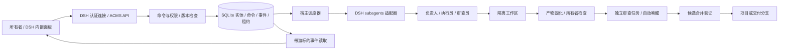
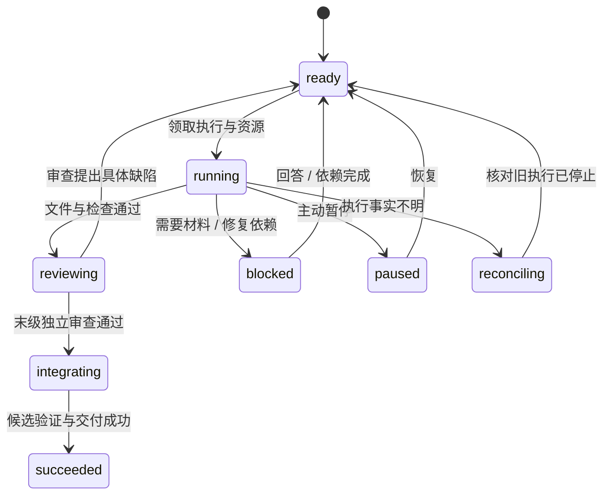

# ACMS 0.1 架构

## 系统结构

ACMS 是 `dsh-acms` host + client bundle；可选执行包为 `dsh-acms-codex`。没有独立产品管理服务器。客户端通过 DSH Fetch 通道访问 `/api/acms/*`，事件采用有游标的 20 秒长轮询。断线后补读事件再刷新快照，不依赖浏览器维持任务运行。

## 数据与事务

SQLite 使用 WAL、FULL synchronous、同步短事务。文件与模型调用不放进数据库事务。核心集合：projects、goals、tasks、agents、workflows/history、attempts、artifacts、verifications、interactions、migrations。

每次写入递增实体 revision；编辑可以携带 `expectedRevision` 防止覆盖。命令的 requestId 与参数指纹一起持久化，同一请求重放返回原结果，不同参数复用同一 ID 会被拒绝。数据库事务提交后才发布事件。

调度器使用进程租约及 epoch。存活或无法确认死亡的旧进程不会被接管。执行前先持久化 attempt，再调用 provider；收到 activation 后持久化 child ID。该设计无法令模型调用与 SQLite 实现跨进程原子提交，因此对“调用已接受但 child ID 尚未保存”等窗口采取保守核对。

## 执行与审查

完成执行只提交结果；不能直接写 `succeeded`。检查通过后，在同一事务中推进流程并创建 review task，下一次调度立即唤醒审查员，不需要所有者发消息。审查与原作者使用不同 agent 身份。审查员使用独立验证副本，可以创建测试临时文件；原作者工作区不在其可写根目录中。

交付物复制到按内容标识的 blob，记录大小和哈希；Git 变更集额外固定所有修改文件的哈希。审查前后检查版本一致。源码文本在受限大小内随审查合同提供，宿主检查结果单独提供。审查失败返回实现阶段；工具环境失败要求报告 technical blocker，重试审查而非虚构交付缺陷。

流程版本在创建任务时固定。发布新版本不改变在途合同。所有者可在安全状态显式迁移任务，递增 generation、废弃旧审查并暂停；恢复后重新执行与验收。

## 公司治理与资源

所有者控制目标、项目路径、可执行检查、provider/model 白名单、并发和预算。管理角色可以在授权目标内创建任务、调整依赖/分工、管理角色与发布工作流，不能扩大所有者边界。原生工具身份由 live activation 推导；不会接受模型传入的身份字符串。

默认最大 4 个 AI 执行，其中协调预留 1 个，普通执行最多 3 个。同一 agent 同时只接一个任务。释放资源必须等 provider 清理确认；未知执行与待清理执行仍占资源。内置 Codex 的 ACMS 模式禁用原生 multi_agent 功能，任务拆分统一返回调度器管理。

本版提供单次运行时间、目标累计 AI 运行时间、重试、返工、任务数与临时人员上限。时间额度按各 attempt 的运行时间求和，非账单费用。预算在调度 tick 检查并请求终止，操作系统清理耗时不保证精确到毫秒。

## 上下文与生命周期

上下文 key 包含公司目标、任务、角色、agent、合同 generation。重试沿用同一 key；不同任务相互隔离。长期任务保留角色与线程，短期任务结束释放子进程和临时角色；历史输出、证据和线程记录保留，不自动删除。

正常宿主退出会取消在途执行，清理成功后记录可恢复标志；下次加载自动恢复这部分任务。所有者主动暂停保持暂停。异常退出后查 provider 的 attempt ID、终态收据和清理锁：能证明完成则接收收据，能证明停止则重新调度，事实不明则进入 reconciling。

本版没有脱离 DSH 的常驻守护进程。单个任务被阻塞时，无依赖的其他任务继续执行。

## 代码与文件隔离

Git 模式从源项目当前提交创建专属 worktree；目录模式复制源码并排除常见认证目录、环境文件及 symlink。后者是工作隔离而不是安全沙箱，实际文件访问边界由 provider 执行环境提供。

启用自动集成时，先确认交付未变化、源目录干净，提交执行分支；基于目标最新 HEAD 创建隔离合并候选，合并、运行检查，再确认源目录与 HEAD 未变化，最后 fast-forward。候选失败保留诊断目录，源项目保持原样。ACMS 内部串行集成；外部工具同时操作同一 Git 仓库仍需项目所有者协调。

所有者验收脚本应放在执行员工作区之外，避免把“可以修改的项目测试”误当作不可修改的验收依据。项目内测试可作为补充检查。0.1 不自动生成可靠的所有者验收规范。
