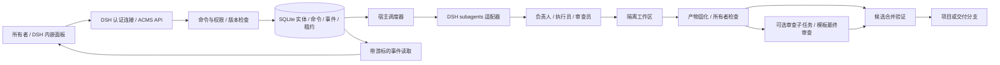
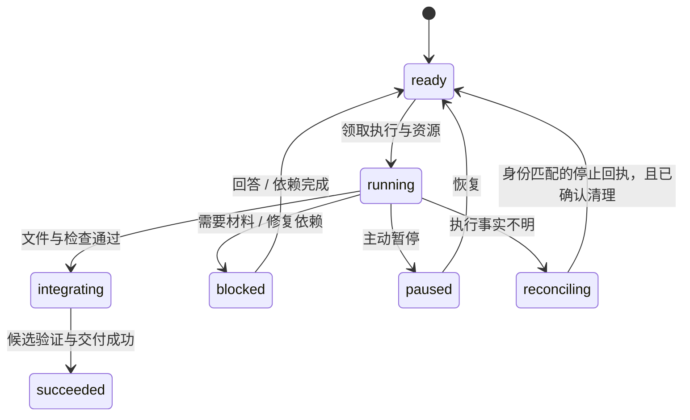

# ACMS 0.1 架构

## 系统结构

ACMS 是 `dsh-acms` host + client bundle；内置 `@acms/codex-runtime` 会话库处理 Codex app-server 配对执行。没有独立产品管理服务器。客户端通过 DSH Fetch 通道访问 `/api/acms/*`，事件采用有游标的 20 秒长轮询。断线后补读事件再刷新快照，不依赖浏览器维持任务运行。

## 数据与事务

SQLite 使用 WAL、FULL synchronous、同步短事务。文件与模型调用不放进数据库事务。核心集合：projects、goals、tasks、agents、templates/history、workflows/history（旧阶段制数据，只读保留）、attempts、artifacts、verifications、interactions。

每次写入递增实体 revision；编辑可以携带 `expectedRevision` 防止覆盖。命令的 requestId 与参数指纹一起持久化，同一请求重放返回原结果，不同参数复用同一 ID 会被拒绝。数据库事务提交后才发布事件。

调度器使用进程租约及 epoch。存活或无法确认死亡的旧进程不会被接管。执行前先持久化 attempt，再调用 provider；收到 activation 后持久化 child ID。该设计无法令模型调用与 SQLite 实现跨进程原子提交，因此对“调用已接受但 child ID 尚未保存”等窗口采取保守核对。

## 执行与审查

任务是最小执行粒度，没有阶段、没有 `reviewing` 等待态。执行完成只提交结果；检查通过后进入集成并交付。审查是独立子任务（`kind=review`），由用户按需添加，或由目标模板在交付时自动创建一次；它读取交付物快照、验收标准和自动检查结果，不读取执行过程。审查与原作者使用不同 agent 身份，并使用独立验证副本。

目标模板（`templates`）是版本化的目标级方案，基础模板为「拆分 → 执行 → 最终审查」。目标在创建时固定模板快照（`templateSnapshot`），之后发布新版本不会改变在途目标的审查策略。含最终审查的模板会在所有非审查任务交付后创建一次总体审查；不含审查的模板在交付后直接完成，记录“按用户配置未审查”。模板属于所有者边界。

旧阶段制数据的自动迁移在 `Engine.start` 取得调度租约之后、恢复执行之前进行：逐条核对旧 attempt 的执行回执，只有确认清理的才归档并释放名额；无法确认时阻止启动且不改数据，旧宿主持有租约时也不会先迁移。

交付物复制到按内容标识的 blob，记录大小和哈希；Git 变更集额外固定所有修改文件的哈希。审查前后检查版本一致。审查失败不重开被审任务：写入失败证据并生成负责人协调任务，目标恢复 active，由负责人决定返工范围。返工次数按目标/交付链累计；达到上限或没有可用负责人时，改为创建一个可回复的阻塞协调任务（所有者门控），恢复负责人后由调度器自动接续。审查员必须不是任何被审成果的作者，创建与受理时都会校验。工具环境失败要求报告 technical blocker，重试审查而非虚构交付缺陷。

## 展示投影

快照为项目、目标与任务附带 `activityAt`：白名单业务事件（创建、执行开始/结束、产物提交、审查结论、用户回复、协调决定）先按 `body.taskId` 或所属 attempt/interaction 归到任务，再取最大时间；任务沿 `parentId`/`reviewOf` 聚合后代活动（带循环保护），目标与项目再逐级向上聚合。历史缺失时回退到创建时间。进度、心跳、通知和轮询事件不计入，因此轮询不会把条目置顶。折叠状态按对象保存在展示层；已完成列表、默认收起和活动排序只影响展示，不写业务状态、不改变审查结论、依赖或调度顺序，目标进度仍按全部任务计算。

## 阻塞分级与负责人接管

调度器按阻塞类型决定归属：审查环境失败、服务失败/重试耗尽、选模无候选、集成冲突等可恢复阻塞自动创建（或复用）当前目标的负责人协调任务，由负责人在既有授权内决定重试、换分派、缩小范围或调整依赖；只有新增权限、必须由所有者提供的材料、跨范围重大变化、真实预算不足，以及重试已耗尽且负责人已处理过的同类阻塞仍需所有者决定。未知阻塞类型默认交给所有者，不会被负责人静默吸收。

协调入口按「任务 + generation + 阻塞类型」幂等：同一阻塞重复上报复用未结束的协调任务，决定、动作与结果分别记录在协调任务、动作批次和事件中；负责人在结束后同一阻塞再次出现时回到所有者，避免自动化循环。暂停、取消、执行清理未确认、跨目标或已停用负责人、权限收窄和成本硬上限都不会被该路径绕过：暂停任务保持暂停，清理未确认保持 reconciling，无可用负责人时回退为所有者分派问题。负责人的决定在受理时重新核对当前角色与授权，不能凭旧 attempt 释放任务。

## 公司治理与资源

所有者控制目标、项目路径、可执行检查、目标模板、provider/model 白名单、并发和预算。管理角色可以在授权目标内创建任务、调整依赖/分工、管理角色，但不能发布目标模板或改变审查选择，也不能扩大所有者边界。原生工具身份由 live activation 推导；不会接受模型传入的身份字符串。

默认最大 4 个 AI 执行，其中协调预留 1 个，普通执行最多 3 个。同一 agent 同时只接一个任务。释放资源必须等 provider 清理确认；未知执行与待清理执行仍占资源。内置 Codex 的 ACMS 模式禁用原生 multi_agent 功能，任务拆分统一返回调度器管理。

本版提供单次运行时间、目标累计 AI 运行时间、重试、返工、任务数与临时人员上限。效率时间盒与成本硬上限分开：时间盒到点保存检查点、只生成一条负责人收尾协调任务并暂停普通派发，负责人决定（收尾或调整范围）后恢复；没有可用负责人时创建可回复的所有者门控。硬上限仍在调度 tick 检查并走既有预算阻塞/清理路径；时间盒不会自动追加预算，也不会绕过硬上限、暂停、权限或清理占位。时间额度按各 attempt 的运行时间求和，非账单费用。

## 上下文与生命周期

上下文 key 包含公司目标、任务、角色、agent、合同 generation。重试沿用同一 key；不同任务相互隔离。长期任务保留角色与线程，短期任务结束释放子进程和临时角色；历史输出、证据和线程记录保留，不自动删除。

正常宿主退出会取消在途执行，清理成功后记录可恢复标志；下次加载自动恢复这部分任务。所有者主动暂停保持暂停。异常退出后查 provider 的 attempt ID、终态收据和清理锁：能证明完成则接收收据，能证明停止则重新调度，事实不明则进入 reconciling。

本版没有脱离 DSH 的常驻守护进程。单个任务被阻塞时，无依赖的其他任务继续执行。

## 任务工作台的展示投影

任务工作台的默认范围、依赖图分区与折叠只影响展示，不写入任务、依赖或调度状态。打开工作台时默认聚焦"近期有效业务活动"最新的项目：优先仍有未完成任务的项目，按任务 `updatedAt` 比较，同值时按项目创建时间与 ID 稳定排序；只有一个项目时直接聚焦，没有项目时为"全部项目"。在工作台内新建目标或任务时，表单默认沿用当前聚焦的项目与目标，而不是数组中的第一个项目或第一个目标。选择单个项目后依赖图按目标分区并默认展开、可逐个收起；选择"全部项目"后按项目分区，展开后再按目标分块，分区默认收起且各自显示任务计数。折叠状态按项目/目标键保存在本次页面会话内，数据刷新不会复位，A 项目的展开状态不会带到 B 项目。筛选后只剩一个分区时仍保留分区与折叠状态，不会退化成无分区的直出画布。

依赖只在同一目标内绘制（领域模型要求依赖同目标）。当筛选（搜索、审查开关、范围）隐藏了前置任务时，节点显示"前置未显示"并在图下方提供可展开引用，可跳转查看原任务；跨分区依赖按完整快照的 `projectId`/`goalId` 判定，筛选只影响连线显示，不会把已知归属异常降级为普通隐藏前置；若快照中出现跨分区依赖这类异常数据，图只报告不绘制，不自动修正归属。已完成列表分离等默认展示策略属于后续 issue，不包含在本投影内。

## 代码与文件隔离

Git 模式从源项目当前提交创建专属 worktree；目录模式复制源码并排除常见认证目录、环境文件及 symlink。后者是工作隔离而不是安全沙箱，实际文件访问边界由 provider 执行环境提供。

启用自动集成时，先确认交付未变化、源目录干净，提交执行分支；基于目标最新 HEAD 创建隔离合并候选，合并、运行检查，再确认源目录与 HEAD 未变化，最后 fast-forward。候选失败保留诊断目录，源项目保持原样。ACMS 内部串行集成；外部工具同时操作同一 Git 仓库仍需项目所有者协调。

所有者验收脚本应放在执行员工作区之外，避免把“可以修改的项目测试”误当作不可修改的验收依据。项目内测试可作为补充检查。0.1 不自动生成可靠的所有者验收规范。
