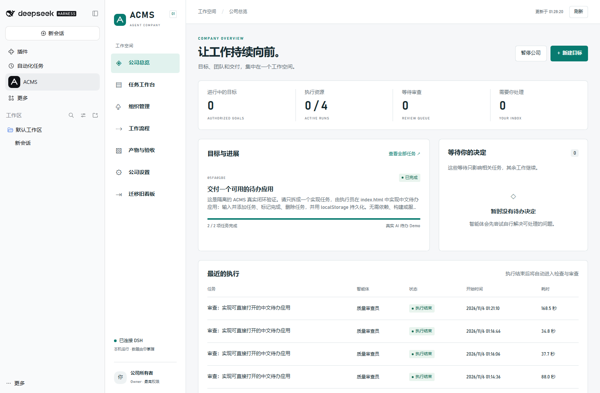

# 验证记录

## 环境与结果

验证环境为 Windows、Node.js 24.22.0、DSH 0.2.1-rc.5（其 Electron 内置 Node.js 24.21.0）、Codex app-server 0.166.0、本机 Chrome。

| 验证层 | 结果 |
|---|---|
| 核心与 provider 自动化测试 | 80 项通过，包含子测试；增加删除/恢复保护、项目与目标原子创建、目录范围、模型分类、思考深度传递和连通性失败/恢复 |
| 语法与包契约检查 | 通过 |
| UI 自动化 | 三组通过：删除恢复、灰色按钮原因、模型列表和仅内部模型父上下文选项、思考深度、检测失败保护、从空公司创建目标、原生目录选择接口、目录浏览及真实剪贴板粘贴；既有迁移等功能回归通过 |
| 真实 DSH 加载 | ACMS host routes、原生侧边栏及内嵌面板通过，浏览器无未捕获错误 |
| DSH 认证边界 | 未认证请求 `/api/acms/state` 返回 401 |
| 真实 AI 任务 | 规划→实现→自动审查→验收→Git 合并成功 |
| 安装/卸载 | 独立 profile 通过；重复安装配置不重复；单独卸载主插件保留 provider 配置 |
| Paperclip 原数据 | 只读预览成功；未迁移、未暂停用户的旧执行 |

## 真实闭环

测试在独立 DSH_HOME、profile、数据库与 Git Demo 项目中执行，使用真实 `acms-codex` provider。目标是生成一个无需服务器、可直接打开的中文待办应用。

系统自动创建规划任务和实现任务，交付后自动创建独立审查任务。宿主运行所有者控制的外部浏览器检查，验证新增、完成/取消完成、指定删除、刷新持久化、空输入、手机布局及浏览器错误。审查员在独立验证副本中重新运行验收并核对交付源码，批准后由集成器验证合并候选并合入 Demo Git 项目。

开发中真实运行曾暴露 Windows 工具初始化和只读临时目录权限问题。修复后采用独立审查验证副本，原交付哈希持续校验；最终目标达到 succeeded，执行资源全部释放。这是修复后的集成验证结果，不表示所有宿主环境都会自动消除权限故障。

机器可读结果见 [native-validation.json](native-validation.json)。原始模型线程、launch token、数据库和详细事件保留在本机 `.acms-lab/`，不进入 GitHub 仓库。



## 测试覆盖

- 任务命令幂等、冲突、越权、依赖环、跨目标操作、内部流程字段注入与计划节点注入。
- 自动审查唤醒、拒绝与返工、材料阻塞不影响其他分支、预算终止、并发与清理资源约束。
- 正常退出后恢复、终态收据重放不重复执行、未知执行核对、原交付在审查期间发生变化。
- Git 成功集成、候选检查失败不修改源项目、审查验证副本不覆盖原作者文件。
- 旧板文档/评论保留、暂停导入、重复导入、活跃旧执行与失效预览拒绝。
- Codex 初始化/恢复协议、跨进程租约、崩溃恢复、事件截断处理、超时/中断、子进程回收及跨线程消息隔离。

## 复现

```powershell
npm ci
npm run check
npm test
npm run build
npm run test:ui
npm run test:usability
npm run test:structure
npm run demo
```

`npm run demo` 与 UI 自动化使用模拟 provider；它们不会产生真实模型费用。真实 DSH 工具位于 `scripts/native-test.mjs`、`scripts/lab-control.mjs`，只针对 `.acms-lab` 中已启动的隔离 host 使用，读取私有启动日志完成认证，不输出 token。

CI 运行核心/provider 测试、构建及 Chrome UI 测试；真实 DSH 与模型验证仍是本机集成验收，因为 CI 没有用户的宿主安装和登录凭证。

本轮正式 Desktop 验证：外部 `gpt-6-astra` 经独立临时线程实际调用通过，服务返回思考深度 `xhigh`（约 4.4 秒）；内部 `deepseek-flash` 经 DSH 通道实际调用通过（约 0.9 秒），读取到当前默认深度 `max`，支持 `off / low / high / max`。两项结果均已在正式面板和诊断记录中核对。未创建、修改或删除用户业务任务。

## 2026-11-06 层级与模型列表更新

增加空目标/删除状态汇总、任务祖先链、带确认的彻底删除、一次性外部配对、回执变更拒绝、真实子进程自动任务与审查、取消回收测试。新界面测试覆盖项目/目标定位、多级子任务创建及返回父任务、回收站彻底删除、配对配置确认，并统计检测请求：打开页面、选模型、配对期间均为 0，点击检测后才增加。迁移代码与原数据不变。

外部模型的新运行协议使用模拟 runner 完成进程与 UI 验证；此前真实 gpt-6-astra 的检测属于已停用的旧桥接路径，不作为新配对协议的真实模型验收证据。

正式 desktop 已热更新为 host `f82f7ee329856748`。通过 DSH 可访问性界面核对：现有目标显示“暂无任务 · 0/0 项完成”，已删除的规划任务仅保留在回收站；新模型页显示 DSH 内部模型，打开时没有新增检测记录。手动触发检测后，`deepseek-flash` 实际请求成功（754 ms），显示当前 DSH 默认思考深度 `high`。本轮没有新增、删除或恢复正式业务任务，也没有注册外部测试模型。
